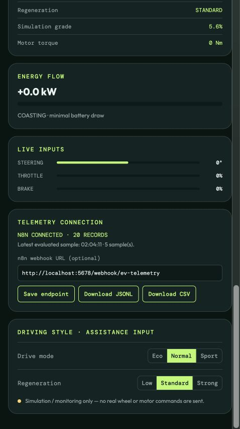
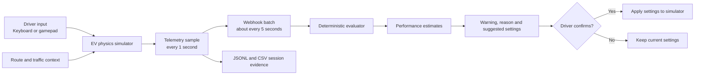
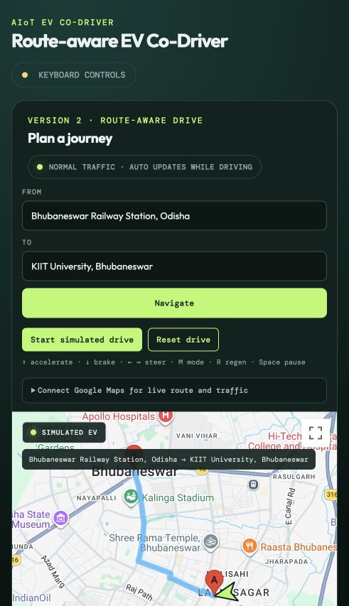
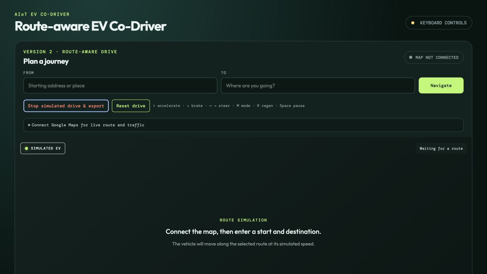

# REGENX — Route-Aware EV Co-Driver Simulator

> An explainable software prototype that combines EV simulation, route context, continuous telemetry and driver-confirmed efficiency coaching.

REGENX explores how a future electric-vehicle co-driver could turn driving behaviour and route conditions into timely, understandable recommendations. It runs entirely as a browser-based simulator, allowing repeatable testing before physical vehicle hardware is introduced.

The current build can simulate an EV journey, calculate a traffic-aware route, transmit telemetry in recurring batches, evaluate driving conditions using deterministic rules, and present suggested drive-mode or regeneration changes. Every setting change remains advisory until the driver presses the confirmation button.



## Project objective

EV dashboards normally display speed, battery state and energy consumption, but they rarely explain what the driver should do next. REGENX demonstrates a more active workflow:

1. Observe driver input, simulated vehicle state and route context.
2. Evaluate the latest telemetry using transparent safety and efficiency rules.
3. Explain the detected condition and recommended action.
4. Require driver confirmation before changing simulator settings.
5. Export the session as evidence for analysis and future model development.

The simulator provides a controlled environment for testing cases such as rapid acceleration, downhill energy recovery, high battery SOC, slow traffic and webhook failure—without risking a real vehicle or battery.

## Current implementation status

| Capability | Status | Notes |
| --- | --- | --- |
| Browser-based EV simulator | Implemented | Speed, torque, grade, SOC and energy flow are simulated. |
| Continuous telemetry | Implemented | Samples are collected every second and sent in approximately five-second batches. |
| Rule-based driving coach | Implemented | Recommendations are deterministic and auditable. |
| Driver-confirmed setting changes | Implemented | The system never changes simulator settings without a button press. |
| Google Maps route and ETA | Implemented | Requires a valid restricted Google Maps API key. |
| Traffic-aware ECO coaching | Implemented | Fresh slow or heavy traffic can produce an ECO recommendation. |
| JSONL and CSV evidence export | Implemented | Each drive can be saved for analysis. |
| Physical IoT or EV hardware | Not implemented | Hardware integration is intentionally deferred. |
| Retrieval-augmented generation | Not configured | The verified workflow reports `rag.status: "not_configured"`. |
| Public automation backend | Not deployed | The tested evaluator currently runs locally. |

## System architecture



An individual webhook execution is expected to finish quickly. “Continuous” monitoring is achieved through repeated requests from the simulator—not by keeping one workflow execution open indefinitely.

## Core features

### EV and energy simulation

- Generic 64 kWh EV battery model
- Speed, road grade, traction torque and energy-flow calculation
- Drive modes: **ECO**, **NORMAL** and **SPORT**
- Regeneration levels: **LOW**, **STANDARD** and **STRONG**
- Battery SOC, estimated range and energy-flow visualization
- Keyboard input and compatible browser gamepad support
- Uphill consumption and downhill regeneration scenarios

### Route-aware driving

- Address-to-address route planning
- Traffic ETA and route distance
- Simulated vehicle movement along the selected route
- Automatic traffic refresh during a running drive
- Route progress and estimated arrival SOC
- ECO advice for fresh slow or heavy traffic

### Explainable co-driver

- Transparent rule-based warnings
- Human-readable reason for each proposed change
- Vehicle warnings take priority over traffic advice
- High-SOC protection prevents inappropriate strong-regeneration proposals
- Driver confirmation is mandatory before applying settings
- Stale or mismatched evaluator responses are rejected

### Evidence and diagnostics

- JSONL event stream for machine processing
- Flattened CSV output for spreadsheet analysis
- Session IDs, event IDs and timestamps for traceability
- Live connection state and last evaluated-sample time
- Batch-level performance estimates labelled as simulated
- Undelivered events retained in the local evidence export

## Repository structure

```text
.
├── src/
│   ├── dashboard/
│   │   ├── index.html            # Main cockpit interface
│   │   ├── styles.css            # Base visual system
│   │   ├── cockpit.css           # Cockpit-specific layout
│   │   ├── cockpit-layer.js      # Display synchronization
│   │   ├── globe.tsx             # Source for the globe visual
│   │   └── globe.bundle.js       # Browser-ready globe bundle
│   └── backend/
│       ├── simulator.js          # Physics, telemetry and UI behaviour
│       ├── navigation.js         # Google Maps route integration
│       ├── terrain-demo.js       # Terrain demonstration logic
│       └── n8n-evaluator-v3-reviewed.js
├── json/                         # Workflow exports and backups
├── images/                       # Verification screenshots
├── markdown/                     # Design, hosting and validation notes
├── package.json
└── README.md
```

`simulator.js` and `navigation.js` are browser-side files despite their location under `src/backend`. The tested evaluator runs separately in the local workflow service.

## Run locally

### Option 1: IntelliJ IDEA

Open `src/dashboard/index.html` and select **Open in Browser**. A typical local address is:

```text
http://localhost:63342/EV-CoDriver-Simulator-v2/src/dashboard/index.html
```

### Option 2: Python web server

From the repository root:

```bash
python3 -m http.server 8080
```

Then open:

```text
http://localhost:8080/src/dashboard/
```

Serving through HTTP is recommended. Opening the page directly through `file://` can cause browser-storage and API-restriction differences.

## Install frontend dependencies

The committed globe bundle is ready to use. Install dependencies only when rebuilding it:

```bash
pnpm install
pnpm run build:globe
```

## Google Maps configuration

Route and traffic features require:

1. **Maps JavaScript API** enabled.
2. **Routes API** enabled.
3. Billing attached to the Google Cloud project.
4. A browser-restricted API key.
5. The exact local or hosted origin added to allowed website referrers.

For IntelliJ’s development server, an appropriate referrer pattern is:

```text
http://localhost:63342/*
```

For the Python server, add the origin you use, for example:

```text
http://localhost:8080/*
http://127.0.0.1:8080/*
```

Enter the key through **Connect Google Maps for live route and traffic**. The key is stored in browser session storage and is not included in this repository.

If the console reports `InvalidKeyMapError`, clear the stored value and reload:

```javascript
sessionStorage.removeItem('evCoDriverMapsKey');
location.reload();
```

Then enter the actual Google Maps key—not the webpage URL. Use specific locations including the city and state to avoid routing to a similarly named place elsewhere.

## Connect the live evaluator

The tested local production webhook is:

```text
http://localhost:5678/webhook/ev-telemetry
```

Do **not** use this test URL for continuous operation:

```text
http://localhost:5678/webhook-test/ev-telemetry
```

A test webhook accepts requests only while a manual test listener is active. The simulator automatically normalizes the known test path to the production path for local use.

The workflow must be published, and both Code nodes must use **Run Once for All Items** because the evaluator processes one telemetry batch and uses `$input.all()` or `$input.first()`.

The workflow sequence is:

```text
Webhook → Driving Evaluator → Performance Metrics (Batch) → Respond to Webhook
```

The **Respond to Webhook** node must return valid JSON. The simulator verifies that the returned session ID and latest event ID match the request before displaying a decision.

## Telemetry request shape

```json
{
  "schema_version": "1.1.0",
  "source": "regenx-ev-co-driver-simulator-v2",
  "session_id": "<uuid>",
  "route_context": null,
  "events": [
    {
      "event_id": "<uuid>",
      "event_type": "telemetry_sample",
      "occurred_at": "<ISO-8601 timestamp>",
      "session_id": "<uuid>",
      "payload": {
        "vehicle": {
          "speed_kph": 42.1,
          "road_grade_percent": -3.2,
          "battery_soc_percent": 81.4,
          "energy_flow_kw": -5.1
        },
        "driver_input": {
          "throttle_percent": 0,
          "brake_percent": 18
        },
        "vehicle_settings": {
          "drive_mode": "NORMAL",
          "regen_level": "STANDARD"
        }
      }
    }
  ]
}
```

The response includes evaluation status, current metrics, warnings, coach reasoning, optional suggested settings, and the identity of the latest evaluated event.

## Coach behaviour

| Scenario | Expected result |
| --- | --- |
| Normal steady driving | Normal status; no setting change recommended |
| Rapid acceleration | Warning with **ECO + STANDARD** suggestion |
| Downhill opportunity below high-SOC limit | **ECO + STRONG** suggestion |
| High SOC during descent | Warning takes priority; no strong-regeneration change |
| Fresh slow or heavy traffic | ECO suggestion; current regeneration preserved |
| Stale traffic information | No traffic-based setting proposal |
| Invalid or unavailable webhook | Disconnected state; old decision cleared |

Suggested settings affect only the simulator and require a driver click.

## Session exports

Select **Download JSONL** or **Download CSV** at any time. Stopping a simulated drive also creates both files.

### JSONL

Best for:

- event-stream processing;
- future retrieval or machine-learning experiments;
- retaining nested telemetry structure; and
- replay or audit tooling.

### CSV

Best for:

- spreadsheets;
- charts and summary statistics;
- presentation evidence; and
- manual review.

## Demonstration sequence

1. Start the local evaluator and confirm the workflow is published.
2. Open the simulator through `localhost`.
3. Confirm the production webhook ends in `/webhook/ev-telemetry`.
4. Connect Google Maps and calculate a route.
5. Start the simulated drive.
6. Confirm **REGENX CONNECTED** and watch the evaluated timestamp advance.
7. Demonstrate rapid acceleration to produce an ECO recommendation.
8. Demonstrate a descent to show regenerative-energy recovery.
9. Apply a recommendation using the driver-confirmation button.
10. Export JSONL and CSV evidence.

## Verification evidence





Detailed validation notes are available in [markdown/VERIFICATION.md](markdown/VERIFICATION.md).

## Public hosting

The frontend is a static browser application and can be hosted on GitHub Pages, Cloudflare or another static host. However, public hosting introduces two separate requirements:

1. Add the final public origin to the Google Maps key’s allowed referrers.
2. Provide a public HTTPS evaluator endpoint and allow the public origin through its CORS configuration.

A hosted webpage cannot access the developer’s `localhost:5678`. Without a public evaluator endpoint, the hosted version remains a functional EV and route simulator, but live workflow decisions are available only on the presentation laptop.

See [markdown/HOSTING.md](markdown/HOSTING.md) for deployment considerations.

## Security guidelines

- Never commit Google Maps keys, Cloudflare tokens or evaluator credentials.
- Keep `.env`, private keys, IDE state and generated files out of version control.
- Restrict browser API keys to the exact development and production origins.
- Use HTTPS for public telemetry.
- Restrict CORS to known origins.
- Rotate any credential that was previously published or committed.
- Keep the evaluator advisory-only until proper automotive validation exists.

## Known limitations

- Vehicle, battery, terrain, SOC and energy values are simulated.
- Road grade currently comes from the simulator course, not the selected real-world route.
- Arrival SOC is a simplified model estimate, not a calibrated vehicle prediction.
- The driving score represents the current webhook batch, not a long-term driver profile.
- Route traffic represents the provider’s route segments, not a guarantee about the vehicle’s exact position.
- Aggressive browser or operating-system tab suspension can still affect very long background sessions.
- RAG is not configured in the verified workflow.
- No CAN bus, motor controller, braking hardware or physical battery is connected.

## Responsible-use statement

REGENX is a simulation and research demonstrator. It is not a certified automotive safety system, energy meter or vehicle controller. A real-vehicle implementation would require calibrated sensing, secure vehicle interfaces, functional-safety engineering, cybersecurity controls, controlled hardware-in-the-loop testing and supervised road validation.

## Documentation

- [Design guide](markdown/DESIGN.md)
- [Local demonstration guide](markdown/LOCAL_DEMO.md)
- [Hosting notes](markdown/HOSTING.md)
- [Verification report](markdown/VERIFICATION.md)
- [Route-coach workflow notes](markdown/N8N-ROUTE-COACH-PATCH.md)
- [RAG ingestion notes](markdown/N8N_RAG_INGESTION.md)

## License

No open-source license has been selected. Until a license is added, the repository remains copyright-protected and reuse requires the owner’s permission.
